# Gallery

These plots show where Pchips differs from SciPy's `PchipInterpolator`, and how its options differ from each other. They are generated by [make_gallery.py](scripts/make_gallery.py): run `uv run python scripts/make_gallery.py` to regenerate them.

## Preserving versus imposing monotonicity

### Peaks and troughs

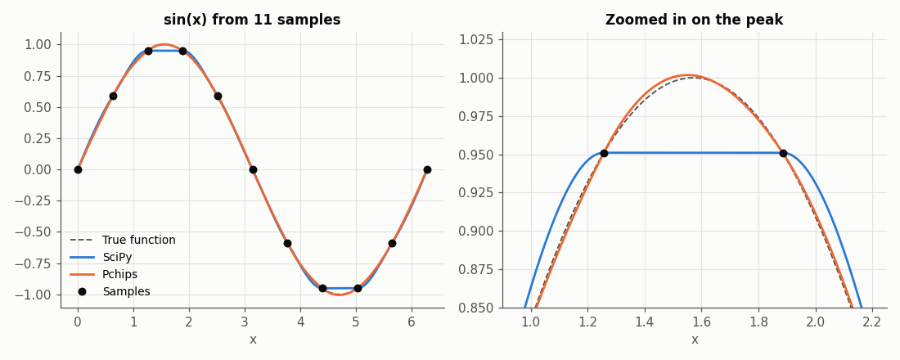

When the peak of $\sin(x)$ falls between two samples, the data slopes change sign there. SciPy's interpolant _imposes_ monotonicity by setting the derivative to zero at both samples, which cuts the peak off flat at 0.951. Pchips only _preserves_ monotonicity where the data are monotone, so it follows the curve up to 1.002, close to the true peak of 1. The maximum error is 0.049 for SciPy and 0.0055 for Pchips.

### Accuracy as the samples get denser

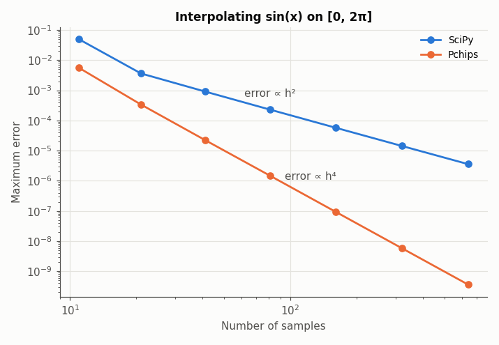

Flattening every peak and trough limits SciPy's interpolant to $O(h^2)$ accuracy, while Pchips is $O(h^4)$: doubling the number of samples cuts SciPy's error by a factor of 4, and Pchips' by 16. With 641 samples, the maximum error is 3.6e-6 for SciPy and 3.6e-10 for Pchips.

### Monotone data stay monotone

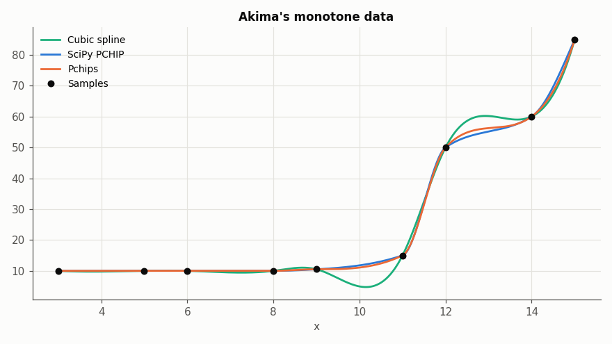

On monotone data, both PCHIPs give a monotone interpolant with no overshoot, unlike a cubic spline, which dips to 4.74 on data which never go below 10 and bulges above 60 between the samples at 50 and 60.

### The price: overshoot on rough data

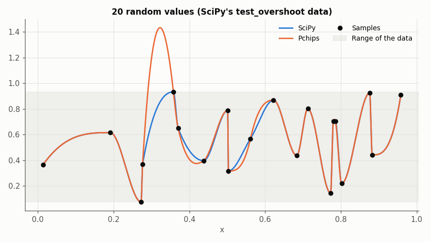

Relaxing the constraint near peaks and troughs means Pchips can overshoot the data there. On smooth data the overshoot is small and usually closer to the truth, as in the first plot. On rough data it can be large: on these 20 random values in [0.08, 0.93], from SciPy's own `test_overshoot`, Pchips reaches 1.43, while SciPy stays within the range of the data.

## Cubic versus quartic

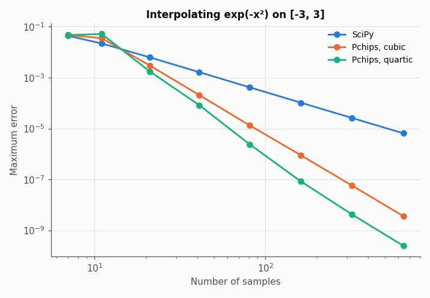

Both derivative approximations give an $O(h^4)$ interpolant, but the quartic one has a smaller error constant: with 641 samples of $e^{-x^2}$, the maximum error is 3.6e-9 with cubic and 2.5e-10 with quartic (and 6.5e-6 with SciPy). With very few samples, however, quartic can be worse, since it relies on the data being smooth over five neighbouring samples rather than four: with 11 samples, the error is 3.6e-2 with cubic and 5.2e-2 with quartic. Use quartic once the samples resolve the shape of the data.

## M3 versus M4

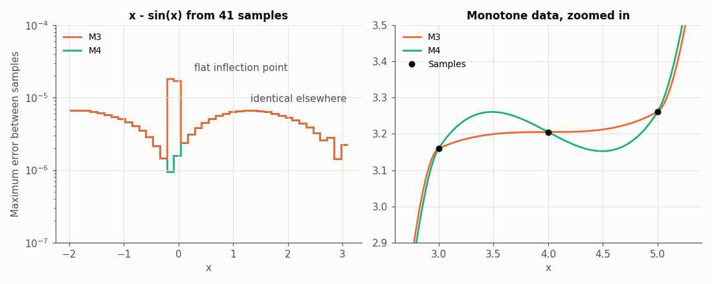

**Left**: M3 and M4 give the same interpolant except near a flat inflection point, where the slope of a monotone function drops to zero between samples, as for $x - \sin(x)$ at $x = 0$. There, M3 clips the derivatives to keep the interpolant monotone and loses accuracy: with 41 samples, the maximum error is 1.8e-5 with M3 and 6.7e-6 with M4.

**Right**: the price of M4. To stay fourth-order accurate, M4 allows derivatives which can make the interpolant non-monotone on rough monotone data. On this data set, which increases at every sample, the M4 interpolant decreases by 0.11 between $x = 3.5$ and $x = 4.5$, while the M3 interpolant stays monotone.

## Classic data sets

These are the data sets in [data](data), which the tests also use. Each plot compares SciPy with Pchips' default settings.

### Hyman

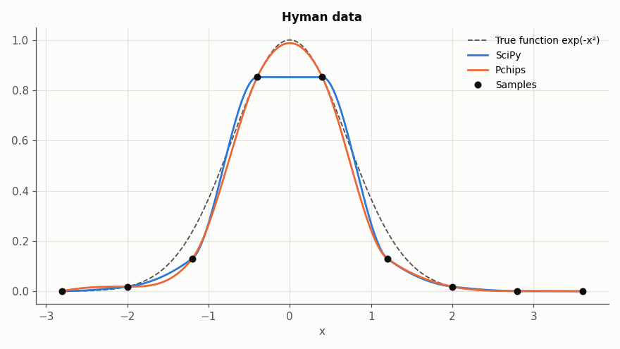

Nine samples of $e^{-x^2}$, with the peak between the samples at $\pm 0.4$. SciPy cuts the peak off flat at 0.852, an error of 0.148, while Pchips reaches 0.988, an error of 0.012. Away from the peak, nine samples are too few for either interpolant to follow the curve closely, and Pchips is off by up to 0.128 at $x = 1.06$.

### Moler

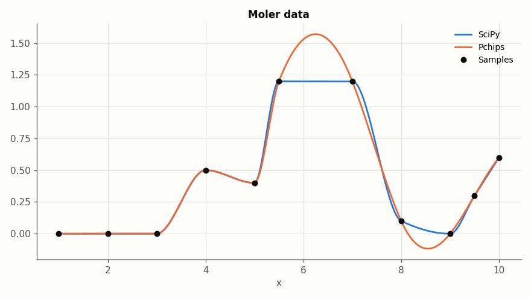

Rough, non-monotone data with plateaus and sharp turns. SciPy stays within the data, flat across the plateau at 1.2. Pchips treats the two samples at 1.2 as either side of a peak and rounds it off up to 1.57, then dips to -0.118 between the samples at 0.1 and 0. This is the overshoot described in [Reasons not to switch](README.md#reasons-not-to-switch): if the plateau and the zero floor are real features of the data, SciPy is the better choice here.

### Akima

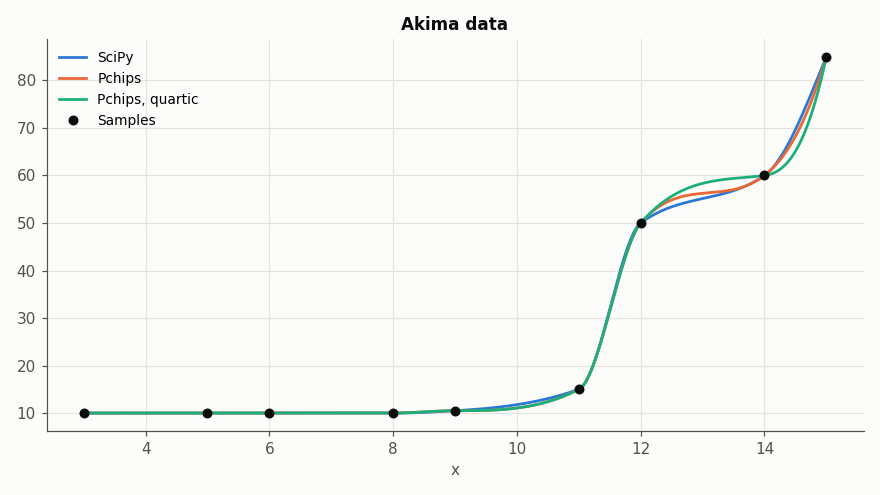

Monotone data with a sharp rise, one of the test cases in Huynh's paper. All three interpolants are monotone and stay within the data. SciPy and Pchips' default differ by at most 1.8, on the final rise from 60 to 85. The quartic approximation, which draws on more neighbouring samples, stands out between the samples at 50 and 60: it levels off close to 60 (59.4 at $x = 13.5$, against 57.0 and 56.8), then rises more steeply to 85. (See [above](#monotone-data-stay-monotone) for a cubic spline on the same data.)

### RPN 14

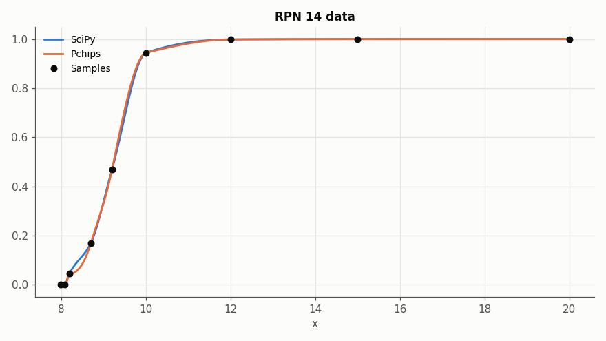

Monotone data which rise steeply and then level off, from Fritsch and Carlson's paper on monotone interpolation, and the other test case in Huynh's paper. SciPy and Pchips are both monotone and differ by at most 0.036, mostly near the bottom of the rise.

### Titanium

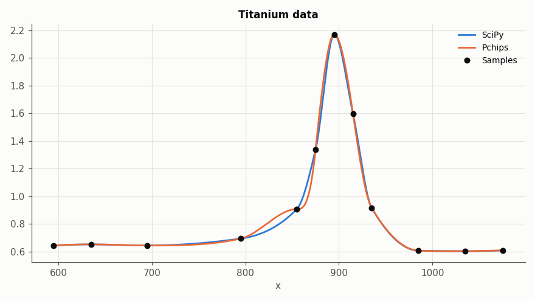

A sharp peak which happens to fall on a sample, so neither interpolant overshoots it, and both stay within the data. They differ by at most 0.12, at the foot of the peak. Pchips is flat for a moment at the sample at $x = 855$: its derivative estimate there came out with the wrong sign for the rising data, so the monotonicity constraint set it to zero.
