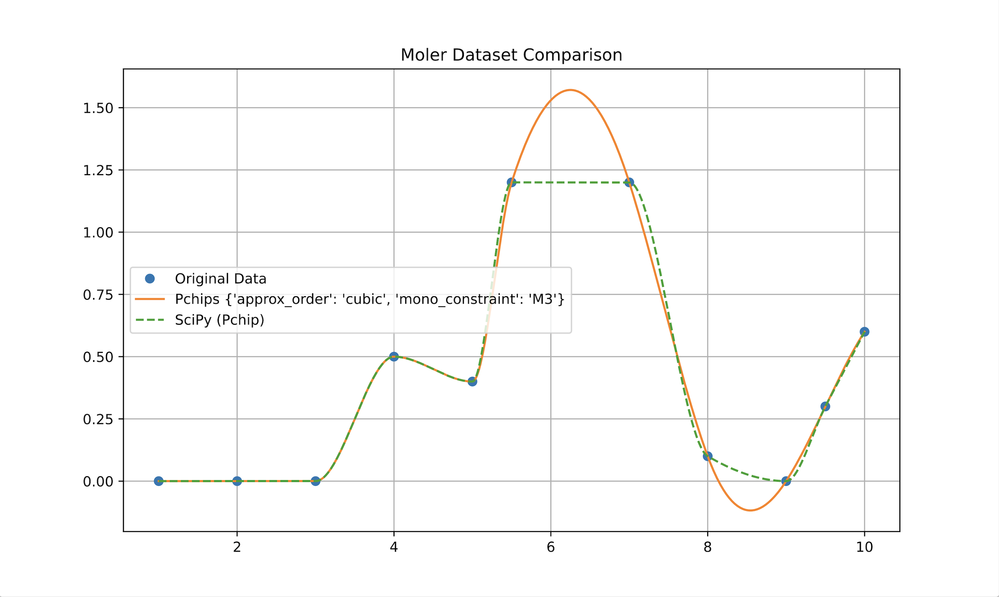

# Pchips



## Overview

This is a Python port, produced using [Gemini CLI](https://github.com/google-gemini/gemini-cli) in an afternoon, of the accurate monotone cubic interpolant [originally implemented in MATLAB here](https://github.com/vglazer/USRA/tree/master/interpolation). It was then refined using [Claude Code](https://claude.com/claude-code): checked against Huynh's paper (which turned up and fixed two bugs in the M4 constraint inherited from the MATLAB original), turned into a drop-in replacement for SciPy's [PchipInterpolator](https://docs.scipy.org/doc/scipy/reference/generated/scipy.interpolate.PchipInterpolator.html), vectorized, and given a more thorough test suite.

All the logic is in [interpolate.py](src/pchips/interpolate.py). The [tests](tests) compare it to SciPy, check the guarantees from Huynh's paper and generate comparison plots. [test_scipy_suite.py](tests/test_scipy_suite.py) runs SciPy's own `PchipInterpolator` tests against it.

The algorithm, due to [H. T. Huynh](https://scholar.google.com/citations?user=ZXhGCtwAAAAJ&hl=en), is described in this [NASA Technical Memo](https://ntrs.nasa.gov/citations/19910011517), which is self-contained and quite readable. A nearly identical version was later published in the [SIAM Journal on Numerical Analysis](https://epubs.siam.org/doi/10.1137/0730004).

## Installation

Pchips requires Python 3.10 or later, NumPy 1.23.5 or later and SciPy 1.10 or later. It is not on PyPI, so install it from GitHub:

```sh
pip install git+https://github.com/vglazer/pchips
# or
uv add git+https://github.com/vglazer/pchips
```

## Usage

Change the import and leave everything else as it is:

```python
# from scipy.interpolate import PchipInterpolator, pchip_interpolate
from pchips import PchipInterpolator, pchip_interpolate

interp = PchipInterpolator(x, y)            # also axis=..., extrapolate=...
interp(u)                                   # also interp(u, nu=1)
interp.derivative(), interp.antiderivative(), interp.integrate(a, b), interp.roots()
```

Like SciPy's version, `PchipInterpolator` is a [CubicHermiteSpline](https://docs.scipy.org/doc/scipy/reference/generated/scipy.interpolate.CubicHermiteSpline.html), so it has the same signature, methods, input validation, output shapes and extrapolation behavior. Two keyword-only options select the variant of Huynh's method:

- `approx_order`: `'cubic'` (default) or `'quartic'`, the derivative approximation
- `mono_constraint`: `'M3'` (default) or `'M4'`, the monotonicity constraint

See below for when to use which. With fewer than five data points, the result is identical to SciPy's.

As with SciPy, extrapolation is on by default and simply extends the first and last cubics, so the interpolant drifts away from the data quickly outside its range. Pass `extrapolate=False` to get `nan` there instead.

### Choosing between cubic and quartic

**Use `'quartic'` if your data are smooth and sampled finely enough to resolve their features, and `'cubic'`, the default, otherwise.**

Why:

- **Quartic is more accurate on well-resolved smooth data**. Both give an $O(h^4)$ interpolant, but the quartic derivative approximation has a smaller error constant. With 321 samples, the maximum error is 3.9e-10 instead of 5.8e-9 for $\sin(x)$, and 4.2e-9 instead of 5.8e-8 for $e^{-x^2}$
- **Cubic can be more accurate on coarse data**. The quartic approximation uses five neighbouring samples instead of four, so it relies on the data being smooth over a wider stencil. With only 11 samples of $e^{-x^2}$ on $[-3, 3]$, the maximum error is 5.2e-2 with quartic and 3.6e-2 with cubic, and the same happens with a steep $\tanh(5x)$ and Runge's function
- **Quartic is about 1.3 times slower to construct**

### Choosing between M3 and M4

**Use M3, the default, unless your data are smooth samples of a monotone function whose slope drops to zero somewhere between the samples**, i.e. a flat inflection point such as $x - \sin(x)$ at $x = 0$ or $x^3$ at $x = 0$.

Why:

- **On most data the two are identical**. For smooth data the constraint only kicks in near points where the slope of the data is close to zero. At peaks and troughs both constraints relax in the same way, which is what gives Pchips its accuracy there. On $\sin$, $e^{-x^2}$, $\tanh$, Runge's function and others, M3 and M4 give exactly the same interpolant
- **M4 is more accurate at flat inflection points**. M3 guarantees monotonicity by keeping the derivative at each sample between 0 and 3 times the smaller of the neighbouring slopes. Near a flat inflection point, the data slopes are tiny, so this clips the derivatives and accuracy drops to roughly $O(h^3)$, and erratically so. M4 uses extra information from neighbouring cubics to allow larger derivatives there and stays $O(h^4)$. For $x - \sin(x)$ on $[-2, 3.1]$ with 641 samples, the maximum error is 7.1e-10 with M3 and 1.0e-10 with M4 (see `test_m4_fourth_order_at_flat_inflection` in [test_vs_scipy.py](tests/test_vs_scipy.py)). For $x^3$, M4 is exact while M3 is not. If the flat point happens to be one of the samples, the two agree again
- **M4 weakens the monotonicity guarantee**. Fourth-order accuracy is incompatible with monotonicity in general: there are monotone data which lie on a non-monotone cubic, and M4 reproduces the cubic. Huynh therefore only guarantees a monotone interpolant where the data are "q-monotone" (Theorem 3 in the paper), and in the two intervals at either end. On rough monotone data this matters: in 300 random monotone datasets, M4 gave an interpolant which decreases somewhere in 82 (equally spaced samples) and 141 (unequally spaced samples) of them, while M3 never did
- **M4 is about 1.6 times slower to construct**

So if your data are noisy or irregular, or a monotone result is a hard requirement, stick with M3. If they are smooth and you need the extra accuracy near flat inflection points, use M4, and check the result for monotonicity if that matters.

## Should you switch from SciPy?

In short: switch if your data come from a smooth underlying function and accuracy matters, especially near peaks and troughs. Stay with SciPy if your code relies on the interpolant never leaving the range of the data.

### Reasons to switch

- **Much higher accuracy near local extrema**. SciPy's interpolant flattens out at every local maximum and minimum, which makes it only $O(h^2)$ accurate there. Pchips is $O(h^4)$ there too, and everywhere else, except at flat inflection points with the default M3 constraint (see above). Here is the maximum error with 321 equally spaced samples (see `test_convergence_vs_scipy` in [test_vs_scipy.py](tests/test_vs_scipy.py)):

  | Function | SciPy | Pchips (default) | Pchips (`approx_order='quartic'`) |
  | --- | --- | --- | --- |
  | $\sin(x)$ on $[0, 2\pi]$ | 1.4e-5 | 5.8e-9 | 3.9e-10 |
  | $e^{-x^2}$ on $[-3, 3]$ | 2.6e-5 | 5.8e-8 | 4.2e-9 |
  | $\tanh(x)$ on $[-3, 3]$ (no extrema) | 2.1e-7 | 1.3e-8 | 1.4e-9 |

  Put differently, Pchips with 41 samples of $\sin(x)$ is about as accurate as SciPy with 321, and the gap grows as you add samples
- **The same monotonicity guarantee**. With the default M3 constraint, monotone data give a monotone interpolant, just like SciPy's
- **Polynomials up to cubics are reproduced exactly**, along with their derivatives and integrals. SciPy's interpolant is not exact even for quadratics
- **Switching is a one-line change**. Only the import changes, and SciPy's own `PchipInterpolator` tests pass, apart from the two which check properties Huynh's method deliberately gives up (see [test_scipy_suite.py](tests/test_scipy_suite.py))

### Reasons not to switch

- **The interpolant may overshoot the data near strict local extrema**. This is the price of accuracy: between any two neighbouring samples, SciPy's interpolant always stays between their values, which is exactly what limits it to $O(h^2)$ at peaks and troughs. How far Pchips overshoots depends on how smooth the data are:
  - **On smooth data the overshoot is small**, and usually closer to the truth, since the underlying function typically peaks between samples. For example, data with a minimum of 0.02 can give an interpolant which dips to -0.004
  - **On rough data it can be large**. In SciPy's `test_overshoot`, which interpolates 20 random values (one of the two expected failures in [test_scipy_suite.py](tests/test_scipy_suite.py)), Pchips leaves the range of the neighbouring samples in 3 of the 19 intervals, by up to 0.50 when the data span 0.86

  If that matters, e.g. for probabilities, concentrations or anything passed to `log`, stay with SciPy or clip the result
- **Construction is 2-9 times slower** (see below). This only matters if you build interpolators in a hot loop
- **Rough or noisy data gain little**, since the higher accuracy relies on the data being smooth

### Performance

Evaluating the interpolant, along with its derivatives and integrals, is exactly as fast as SciPy's, since both use the same `CubicHermiteSpline` code: about 0.5 ms for 100,000 points. Construction does more work, because Huynh's method uses higher-order divided differences and a more elaborate monotonicity constraint. Best of 5 runs on an Apple M3 Max with Python 3.13, NumPy 2.3 and SciPy 1.16:

| Data | SciPy | Pchips (default) | Pchips (`approx_order='quartic'`, `mono_constraint='M4'`) |
| --- | --- | --- | --- |
| 20 points | 0.05 ms | 0.10 ms | 0.18 ms |
| 1,000 points | 0.06 ms | 0.15 ms | 0.28 ms |
| 100,000 points | 1.2 ms | 5.3 ms | 11.4 ms |
| 50 points × 1,000 columns | 0.9 ms | 2.4 ms | 4.7 ms |

## Mathematical background

- Say that you have a bunch of discrete samples $\{(x_i, y_i)\}_{i = 0}^{n}$ which you want to interpolate on using some nice function $f: \mathbb{R} \rightarrow \mathbb{R}$ such that $f(x_i) = y_i, 0 \leq i \leq n$
- [Cubic splines](https://en.wikiversity.org/wiki/Cubic_Spline_Interpolation) are one popular option. They are 4th order accurate (i.e. the error term is $O(h^4)$ ) and quite smooth:
  - Their first derivative $f'$ is not only continuous, but also differentiable (i.e. $f \in C^2$)
  - However, cubic splines may "wiggle" by "overshooting" and "undershooting" the data. This is not visually pleasing and may be problematic for certain applications
- An alternative approach is to construct a [Hermite spline](https://en.wikipedia.org/wiki/Cubic_Hermite_spline), which will match not only the data but also its first derivative:
  - That is, we also have $f'(x_i) = \hat{f'}(x_i), 0 \leq i \leq n$, where $\hat{f'}$ is the approximate derivative of the function sampled to generate the data, produced using e.g. [Newton interpolation](https://en.wikipedia.org/wiki/Polynomial_interpolation#Newton_Interpolation)
  - If $\hat{f'}$ is 3rd-order accurate or higher then $f$ is 4th-order accurate, as with cubic splines. You give up some smoothness, though: while $f'$ is still continuous, it is no longer differentiable (i.e. $f \in C^1$)
  - Moreover, **Hermite interpolants are still not guaranteed to preserve monotonicity**. Meaning, they may be increasing in regions where the data is decreasing and vice versa
- A number of approaches have been proposed for dealing with this, but they generally trade away accuracy in order to preserve monotonicity. For example, [PchipInterpolator](https://docs.scipy.org/doc/scipy/reference/generated/scipy.interpolate.PchipInterpolator.html) uses the method from [Fritsch and Butland](https://epubs.siam.org/doi/10.1137/0905021), which is only 2nd order accurate in general (i.e. no better than linear interpolation):
  - **Intuitively, the issue is that the interpolant _imposes_ monotonicity on the data rather than simply _preserving_ it**
  - This results in "slicing" near local maxima and minima, causing accuracy to degrade
  - The "Monotone Convex" spline introduced by [Hagan and West](https://www.deriscope.com/docs/Hagan_West_curves_AMF.pdf) in the context of forward curve construction also suffers from this problem
  - The modified Akima or ["Makima" interpolant](https://blogs.mathworks.com/cleve/2019/04/29/makima-piecewise-cubic-interpolation/), which is one of the variants supported by SciPy's [Akima1DInterpolator](https://docs.scipy.org/doc/scipy/reference/generated/scipy.interpolate.Akima1DInterpolator.html#scipy.interpolate.Akima1DInterpolator), produces a spline which "appears natural" and avoids slicing for non-monotone data. However, as far as I can tell, it does not guarantee 4th order accuracy. Here is Akima's [original paper](https://dl.acm.org/doi/pdf/10.1145/321607.321609).
- [H.T. Huynh's interpolant](https://ntrs.nasa.gov/api/citations/19910011517/downloads/19910011517.pdf), which is implemented in [interpolate.py](src/pchips/interpolate.py), effectively relaxes the monotonicity constraint near strict local extrema:
  - This results in an interpolant which _preserves_ monotonicity without _imposing_ it. With a 3rd-order or better approximation for $\hat{f'}$, it is $O(h^4)$ accurate, including near local extrema. With the M3 constraint it may drop to $O(h^3)$ at flat inflection points, while the M4 constraint is uniformly $O(h^4)$
  - It's also quite natural-looking, to boot

## Development

- Make sure you have [uv installed](https://docs.astral.sh/uv/getting-started/installation/)
- Clone the repo
- `cd pchips`
- `uv sync`
- `uv run pytest`
- Check out the comparison plots in the `plots` subdirectory

## Citation

If you use Pchips in published work, please cite Huynh's paper:

```bibtex
@article{huynh1993accurate,
  author  = {Huynh, Hung T.},
  title   = {Accurate Monotone Cubic Interpolation},
  journal = {SIAM Journal on Numerical Analysis},
  volume  = {30},
  number  = {1},
  pages   = {57--100},
  year    = {1993},
  doi     = {10.1137/0730004}
}
```

## License

Pchips is released under the [MIT License](LICENSE). [test_scipy_suite.py](tests/test_scipy_suite.py) is adapted from SciPy's tests and keeps SciPy's BSD 3-Clause License, which is reproduced at the top of that file.
